The goal is to make it feel like a real multi-tenant SaaS rather than simply "Jira clone."

Below is the **initial product workflow + architecture + entity relationships**.

# Project 1 — Multi-Tenant Project Management SaaS

## 1. High-Level Product Flow

The fundamental hierarchy should be:

```text
User
 │
 ├── belongs to multiple Organizations
 │
 └── Organization
       │
       ├── Members
       │
       ├── Teams
       │    └── Team Members
       │
       ├── Projects
       │    ├── Project Members
       │    ├── Issues
       │    │    ├── Assignee
       │    │    ├── Team
       │    │    ├── Priority
       │    │    ├── Severity
       │    │    ├── Status
       │    │    ├── Labels
       │    │    ├── Comments
       │    │    └── Subtasks
       │    │
       │    └── Todos
       │
       ├── Activity Logs
       └── Notifications
```

---

# 2. Complete User Workflow

This is the main workflow we will implement.

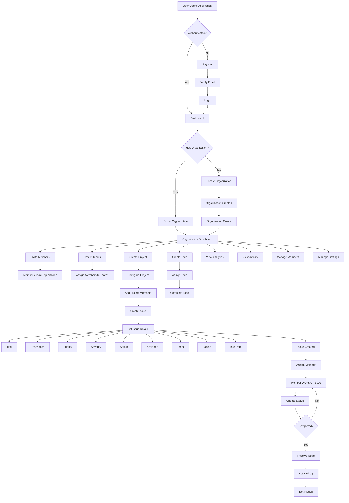

---

# 3. Organization Workflow

An organization is the **tenant boundary**.

This is extremely important architecturally.

A user should never be able to access another organization's data.

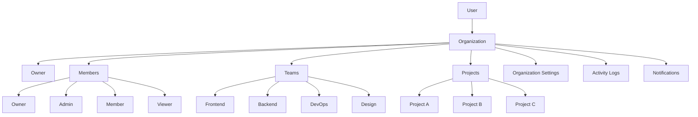

---

# 4. User → Organization Membership

A user doesn't directly belong to one organization.

They can belong to **many organizations**.

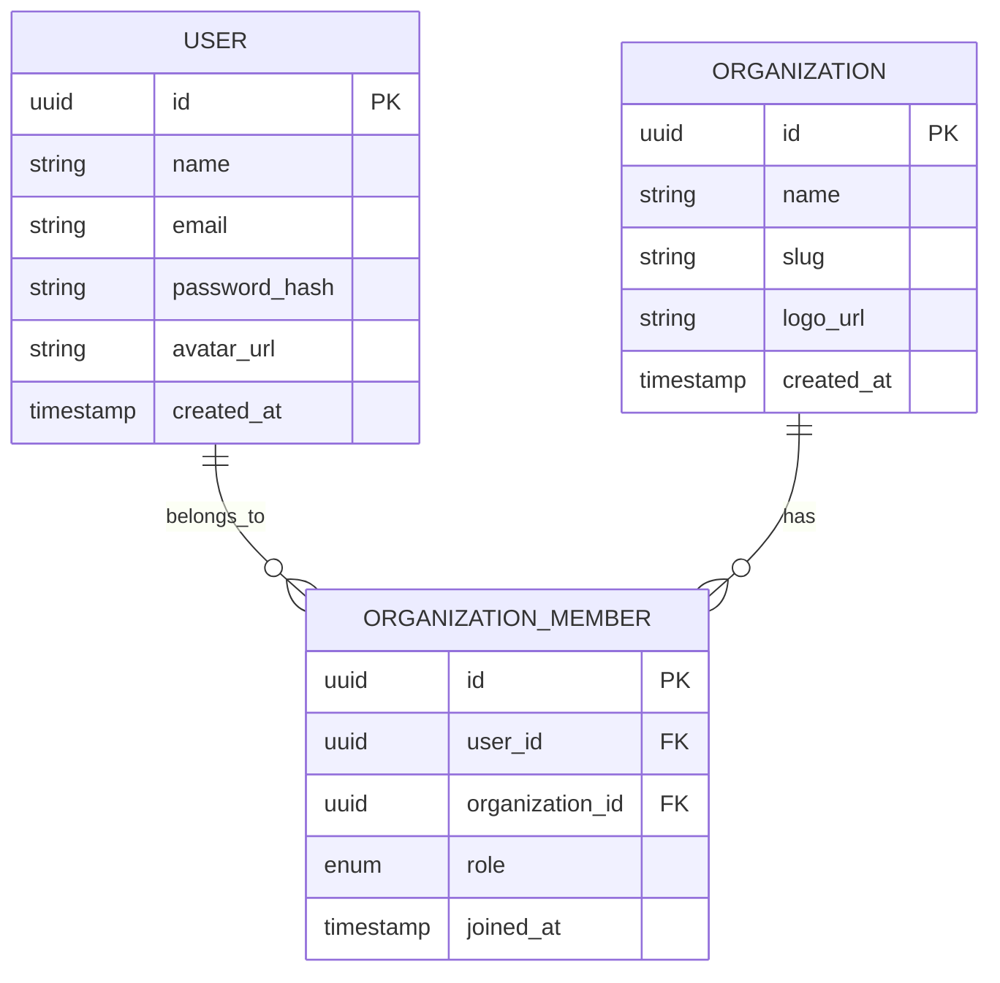

This gives us:

```text
Rizwan
 ├── Acme → Owner
 ├── StartupX → Member
 └── AgencyY → Viewer
```

That's the beginning of the **multi-tenant architecture**.

---

# 5. Member Invitation Workflow

Members shouldn't simply be inserted into the organization.

We'll build an invitation system.

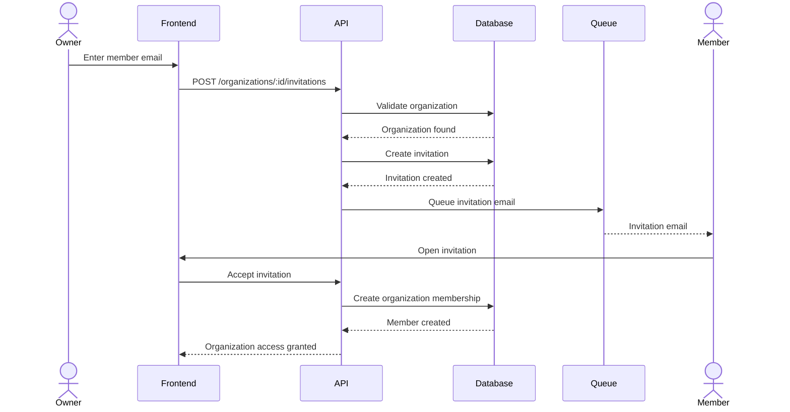

We'll eventually use **BullMQ + Redis** for the email job.

---

# 6. Team Workflow

Teams belong to organizations.

A member can belong to multiple teams.

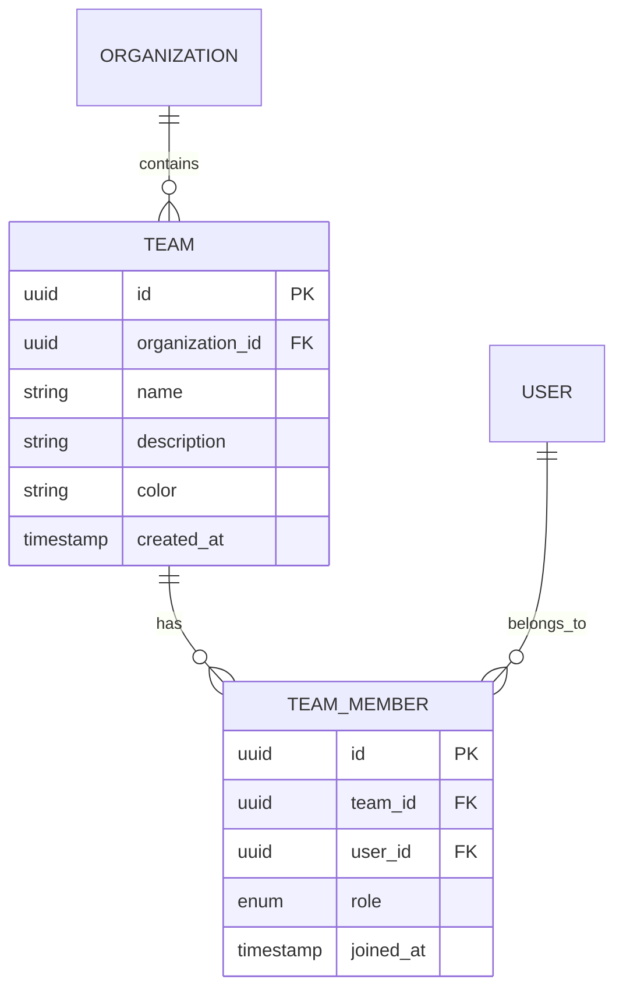

Example:

```text
Acme
│
├── Frontend Team
│   ├── Rizwan
│   ├── Ali
│   └── Ahmed
│
├── Backend Team
│   ├── Rizwan
│   └── Hassan
│
└── DevOps Team
    └── Bilal
```

Notice something important:

**Organization membership ≠ Team membership.**

Someone can be an organization member without belonging to a particular team.

---

# 7. Project Workflow

Projects belong to organizations.

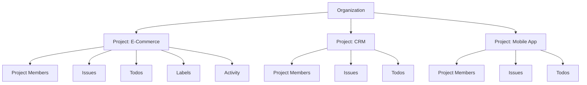

---

# 8. Project Membership

We should **not assume every organization member automatically has access to every project.**

Instead:

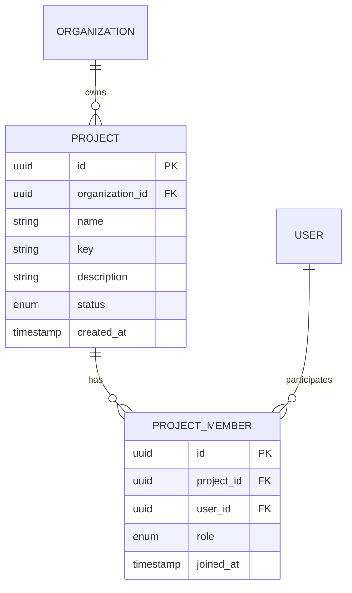

Example:

```text
Organization
│
├── Project A
│   ├── Rizwan
│   ├── Ali
│   └── Ahmed
│
├── Project B
│   ├── Rizwan
│   └── Hassan
│
└── Project C
    └── Bilal
```

This creates another authorization layer.

---

# 9. Issue Workflow

This is where the application becomes interesting.

An issue contains:

```text
Issue
├── Title
├── Description
├── Status
├── Priority
├── Severity
├── Assignee
├── Team
├── Reporter
├── Labels
├── Due Date
├── Comments
├── Attachments
├── Subtasks
└── Activity
```

### Issue lifecycle

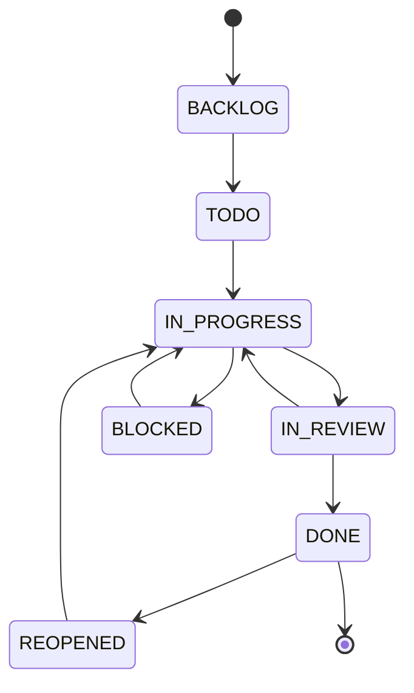

---

# 10. Issue Creation

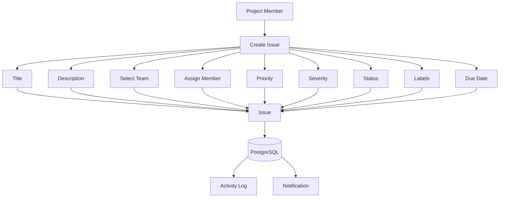

---

# 11. Priority vs Severity

We should deliberately have **both**.

### Priority

How urgently should the team work on it?

```text
URGENT
HIGH
MEDIUM
LOW
```

### Severity

How badly does the problem affect the system?

```text
CRITICAL
MAJOR
MINOR
TRIVIAL
```

So you could have:

```text
Payment completely broken
Priority: URGENT
Severity: CRITICAL
```

or:

```text
Button alignment is wrong
Priority: LOW
Severity: TRIVIAL
```

This is a useful real-world distinction.

---

# 12. Issue Assignment

The assignment should respect team membership.

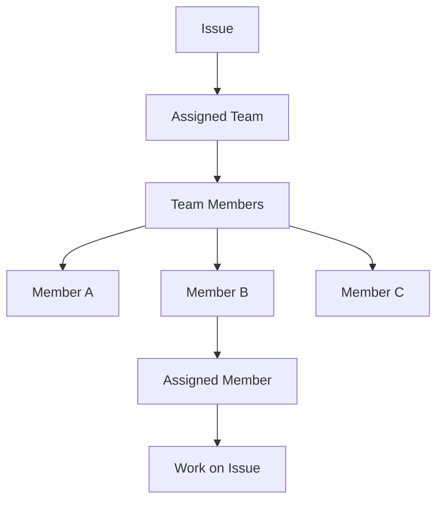

Backend rule:

```text
User
 ↓
Organization Member?
 ↓
Project Member?
 ↓
Team Member?
 ↓
Can be assigned?
```

This gives us a nice authorization problem to solve.

---

# 13. Todos vs Issues

I recommend keeping **Todos separate from Issues**.

### Issue

Represents a piece of project work/problem.

```text
Fix checkout payment failure
```

### Todo

Represents a smaller personal/action item.

```text
Review payment API documentation
```

A Todo can optionally belong to an Issue.

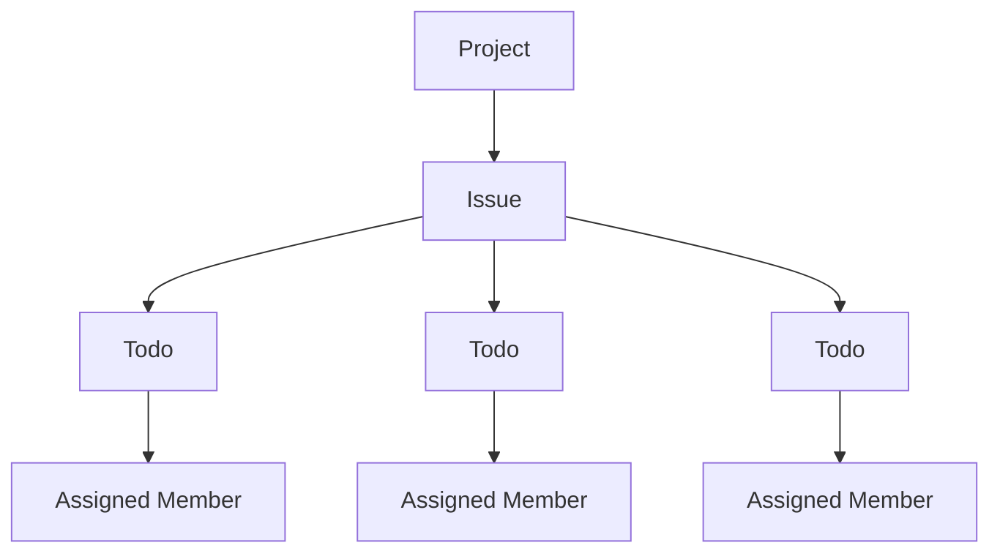

For example:

```text
Issue:
"Checkout payment failing"

Todos:
├── Reproduce payment failure
├── Check Stripe logs
├── Fix webhook handler
└── Add regression tests
```

---

# 14. Comments

Issues can have comments.

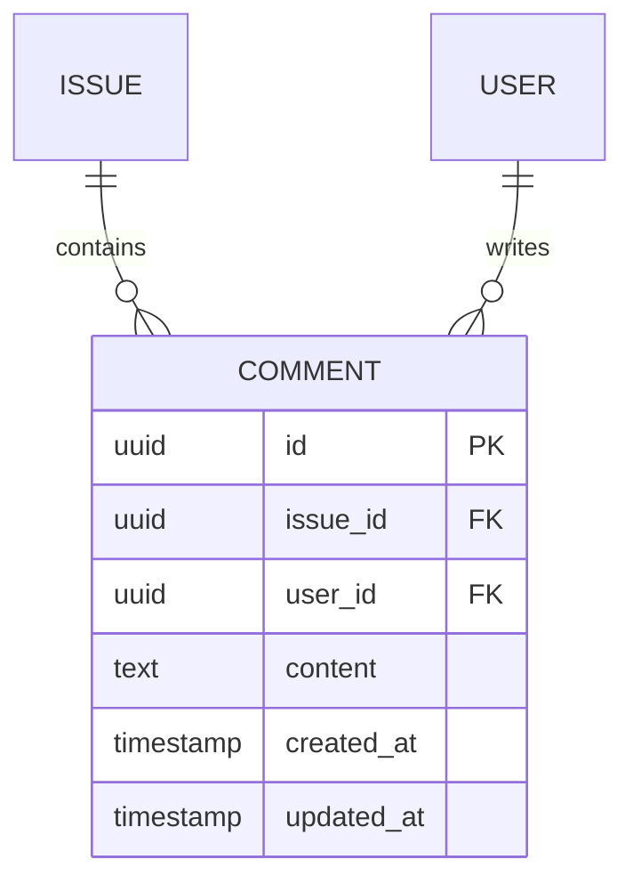

Eventually we can support:

```text
@Rizwan can you check this?
```

which creates a notification.

---

# 15. Labels

Labels belong to an organization/project and can be attached to issues.

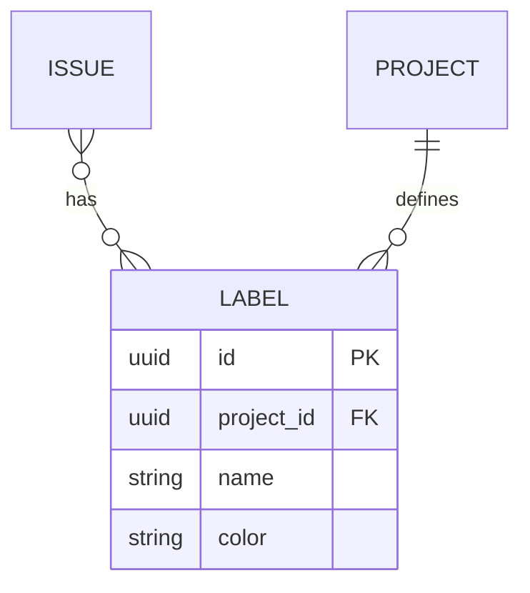

Example:

```text
bug
frontend
backend
security
database
performance
feature
```

---

# 16. Complete Entity Relationship

This is the most important diagram we'll eventually implement in PostgreSQL.

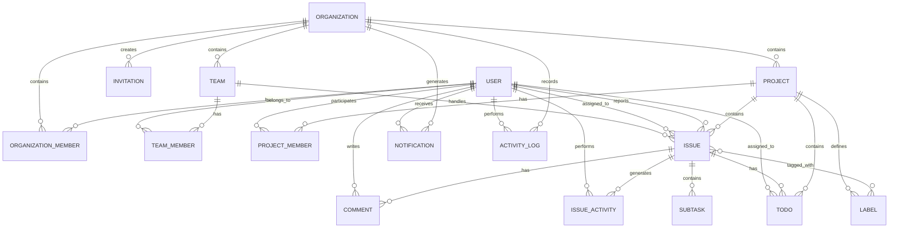

---

# 17. Complete System Architecture

Now let's connect the technologies.

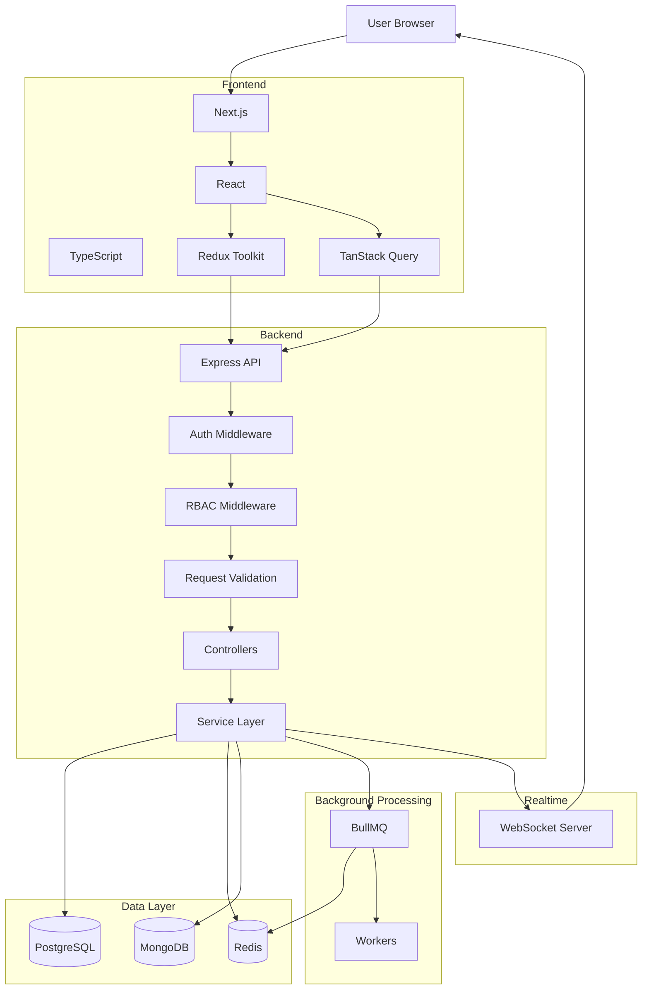

---

# 18. Request Flow

Every protected API request should roughly follow:

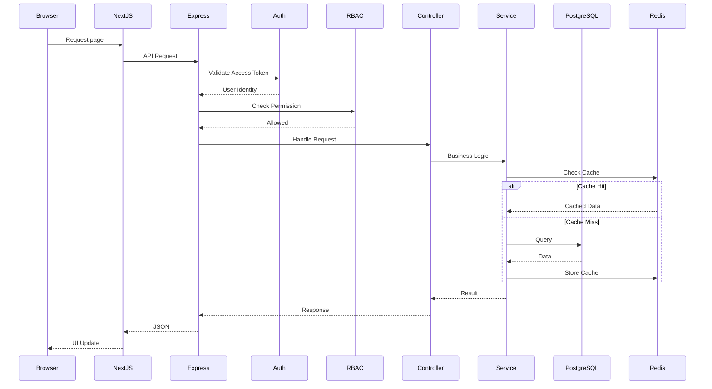

This separation is important:

```text
Controller
    ↓
Service
    ↓
Repository / Database
```

Don't put all your business logic inside Express controllers.

---

# 19. Authentication Flow

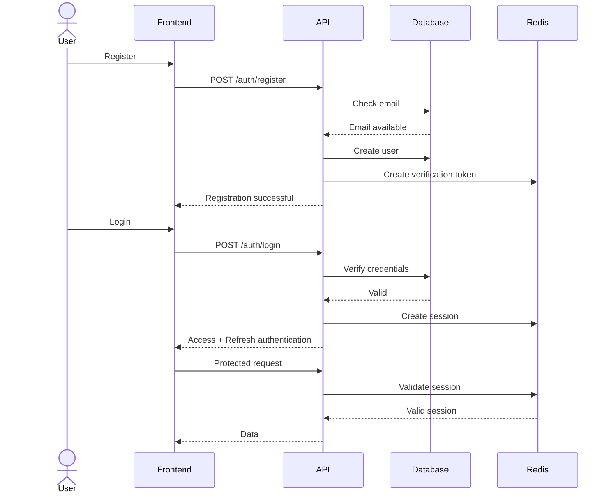

For the implementation, we'll decide later whether to use **HTTP-only cookies with short-lived access tokens + refresh tokens**, rather than exposing sensitive tokens to JavaScript.

---

# 20. Activity System

Almost every meaningful action should generate an activity event.

Example:

```text
Rizwan created issue #123
Ali assigned issue #123 to Ahmed
Ahmed changed priority from Medium → High
Hassan moved issue from In Progress → Review
Rizwan added label "backend"
```

Architecture:

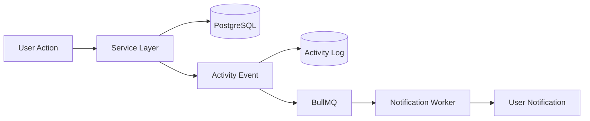

---

# 21. Complete Business Workflow

Putting everything together:

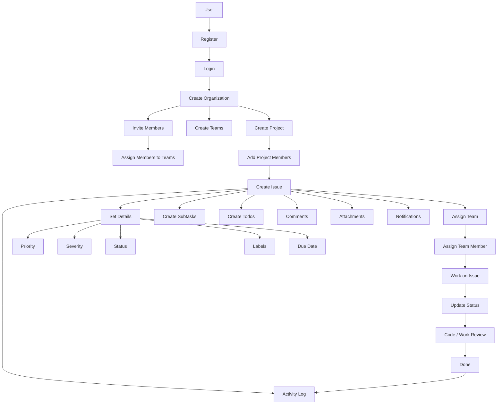

---

# 22. The Final Architecture We Are Building

The whole application can be thought of as:

```text
                         ┌──────────────┐
                         │    USER      │
                         └──────┬───────┘
                                │
                                ▼
                       ┌─────────────────┐
                       │   ORGANIZATION  │
                       └────────┬────────┘
                                │
              ┌─────────────────┼─────────────────┐
              │                 │                 │
              ▼                 ▼                 ▼
          MEMBERS             TEAMS            PROJECTS
              │                 │                 │
              │                 │                 ▼
              │                 │              ISSUES
              │                 │                 │
              │                 │       ┌─────────┼─────────┐
              │                 │       │         │         │
              │                 │       ▼         ▼         ▼
              │                 │   PRIORITY   SEVERITY   STATUS
              │                 │
              │                 └──────► ASSIGNEES
              │
              ▼
          PERMISSIONS
              │
              ▼
          RBAC / ACCESS
```

And underneath it:

```text
                    FRONTEND
                       │
                Next.js + React
                       │
                TanStack Query
                       │
                  Redux Toolkit
                       │
                       ▼
                    EXPRESS
                       │
            ┌──────────┼──────────┐
            ▼          ▼          ▼
          Auth       RBAC      Validation
            │          │          │
            └──────────┼──────────┘
                       ▼
                 SERVICE LAYER
                       │
             ┌─────────┼─────────┐
             ▼         ▼         ▼
        PostgreSQL   Redis     MongoDB
             │         │
             │         ▼
             │      BullMQ
             │         │
             │         ▼
             │       Workers
             │
             ▼
        Activity / Audit
```

## The key design principle

The most important relationship is:

**Organization → Membership → Team → Project → Issue → Assignee**

with permissions being checked at every relevant boundary.

That gives us a realistic authorization model instead of simply doing:

```ts
if (user) {
   return data;
}
```

We're going to be dealing with questions like:

> Is this user authenticated?

→ Is the user a member of this organization?

→ Does their organization role permit this action?

→ Does the user have access to this project?

→ Is the user part of the team?

→ Can this user assign this issue?

→ Is the target assignee actually a member of the relevant team/project?

**That is where the real engineering experience comes from.**

For the next step, I would freeze this workflow and design the **actual PostgreSQL schema + complete ERD**, including every table, PK/FK, indexes, enums, unique constraints, and relationships before writing the backend.


// spme extra
Authentication
RBAC
Multi-tenancy
PostgreSQL
Database design
Transactions
REST APIs
Caching
Redis
Queues
Workers
WebSockets
Notifications
Search
Pagination
File uploads
Testing
Docker
CI/CD
Monitoring
Deployment
Billing