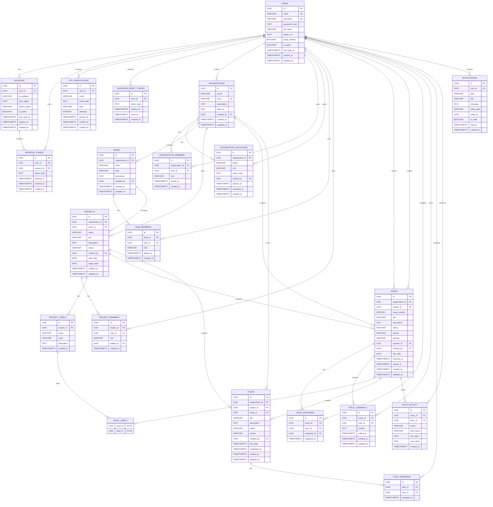
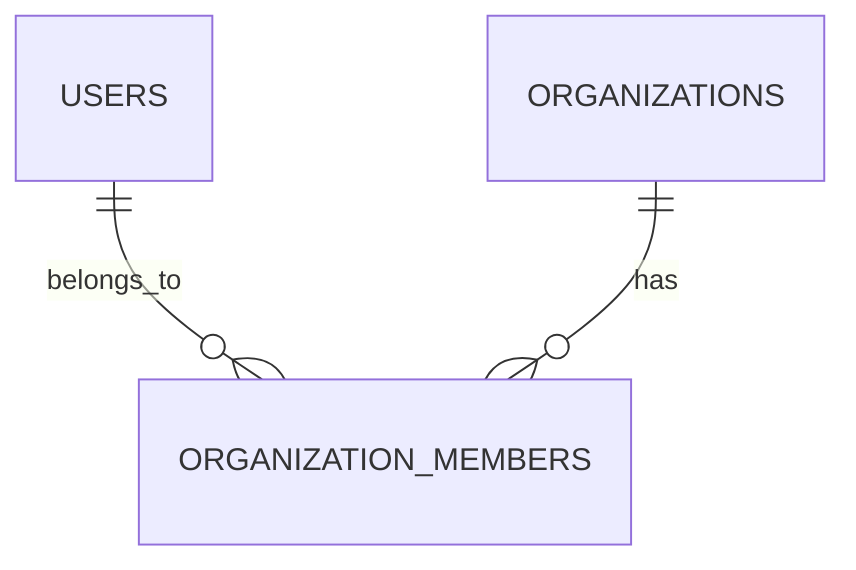
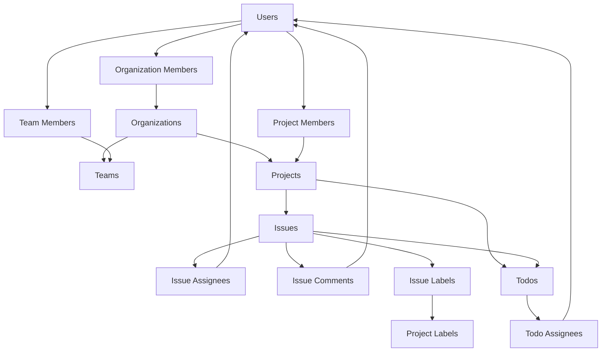

A proper **database ER diagram** where tables are visually connected with relationship lines and each table shows its SQL-style columns.



## How to read the lines

Mermaid ER notation:

```text
||--o{
```

Means:

```text
One ──────── Zero or Many
```

For example:



Visually the relationship means:

```text
                 ORGANIZATION_MEMBERS
                 ┌──────────────────┐
USERS ───────────┤ user_id           │
                 │ organization_id   ├──────── ORGANIZATIONS
                 └──────────────────┘
```

This creates the many-to-many relationship:

```text
USER A ─────┐
            │
USER B ─────┼──── ORGANIZATION MEMBERS ──── ORGANIZATION A
            │
USER C ─────┘
```

---

## Important improvement to the schema

I would make one architectural decision before you start migrations:

### `organization_id` in issues

You technically don't need both:

```text
issues.organization_id
issues.project_id
```

Because:

```text
Issue
  ↓
Project
  ↓
Organization
```

You can determine the organization through the project.

So you have two options.

### Option A — Normalized

```text
issues
├── id
└── project_id
```

Query organization through joins.

### Option B — Denormalized

```text
issues
├── id
├── organization_id
└── project_id
```

Faster filtering but creates duplicate relationship data.

For this project, I recommend **Option A**. It teaches better relational database design.

The same thinking applies to:

```text
todos.organization_id
```

if the todo already belongs to a project.

---

## Simplified relationship hierarchy

Keep this mental model while building:



I recommend keeping **both diagrams** in your `architecture.md`:

1. The large ER diagram — complete database reference.
2. The simplified flowchart — easy mental model.

The large diagram will become difficult to read as your SaaS grows, which is normal in real systems.

---

Any other questions?

**Suggested topic: Database normalization** — relationships, duplication, query design.
